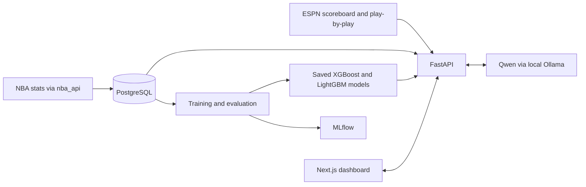

# Courtside NBA Prediction Platform

[](https://github.com/nilkanth-p23/nba-platform/actions/workflows/ci.yml)

Courtside serves calibrated NBA pregame and in-game win estimates, player projections, and a local AI analyst. The analyst calls the same Python services as the dashboard and returns the tool results alongside its answers.



## Run on your Mac

Start Docker Desktop first. Run from the repository root:

```bash
docker compose up -d db
cd backend
test -f .env || cp .env.example .env
.venv/bin/python -m alembic upgrade head
.venv/bin/python -m uvicorn app.main:app --port 8000
```

For a new clone, create the environment with `python3.12 -m venv .venv` and run `.venv/bin/pip install -r requirements.txt -r requirements-dev.txt` from `backend` before migrations. On Apple Silicon, install `libomp` if a native model library needs it. A fresh database requires historical data. The existing Mac database already contains it. For a fresh one, run `python -m pipelines.ingest_games`, `python -m pipelines.ingest_player_logs`, and `python -m pipelines.ingest_pbp --limit 20` from the activated backend environment. Increase the play-by-play limit to expand replay coverage.

In a second terminal, start the Ollama app or run `ollama serve` and install the model with `ollama pull qwen3:1.7b` if it is missing. In a third terminal from the repository root:

```bash
cd frontend
npm ci
npm run dev
```

Open [Courtside](http://localhost:3000) and [API docs](http://127.0.0.1:8000/docs). On dates without games, pick an archived game. For a chat smoke test, ask “How have the Celtics done in their last five logged games?” and open the tool results.

## Model card

| Model | 2025–26 evaluation |
| --- | --- |
| Pregame XGBoost with Platt calibration | Accuracy 67.5%, Brier 0.209, log loss 0.605 |
| In-game calibrated LightGBM | Accuracy 77.9%, Brier 0.147, log loss 0.442 across sampled game states |
| LightGBM player projections | Points MAE 4.826 vs 4.962 baseline, rebounds 1.961 vs 2.018, assists 1.429 vs 1.464 |

The original training scripts use NBA game, player, and play-by-play records, validation on 2024–25, and held-out reporting on 2025–26. The deployed artifacts were refit using all data available at the time, through part of 2026–27. The archive demonstrates inference and can include games seen by the deployed models. Inputs include rolling team/player stats, rest and Elo, and in-game score and clock. Pregame explanations use XGBoost’s TreeSHAP contributions on raw log-odds. Player estimates use the latest logged team and recent minutes, with no injury or lineup feed. Historical results come from the most recent ingestion. The ESPN feed is unofficial and can change.

The Performance page uses forecasts saved while games are still scheduled, then waits for official status and a final score. It compares the model with Elo and an always-home baseline. An empty chart means there are no settled prospective forecasts yet.

## Maintain and verify

Run `python -m pipelines.update daily` from the backend environment to ingest this season’s completed games and player logs, settle earlier forecasts, and publish today’s scheduled games. Run before the first tip in Eastern time. You can also run `ingest`, `backfill`, or `publish` separately. Original game feature export is available via `python -m ml.features`. The app uses the same shift-based feature builders directly.

Backend checks run with `ruff check .` and `python -m pytest -q` in `backend`. Frontend checks run with `npm run lint` and `npm run build` in `frontend`. CI runs on push and pull request. Hosted scheduled workflows require explicit enablement and database configuration.

Local chat uses downloadable Qwen weights on your Mac with no API key or per-request charge. A public dashboard can disable chat with `ANALYST_ENABLED=false`. Keep Ollama bound to loopback for the local demo.
